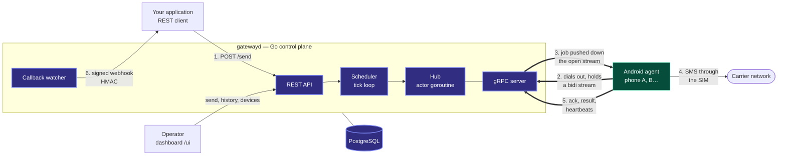

# Relaix

A self-hosted SMS gateway: your Android phones become SMS-sending nodes, managed by a lightweight Go control plane over gRPC.

Rather not run it yourself? A hosted version runs at <https://relaix.kgmadev.com>.

## Status

**Working end to end, single instance — not yet hardened for production.**

`docker compose up --build` brings up Postgres and `gatewayd`; the operator dashboard is at
<http://localhost:8080/ui>. An Android phone running the agent enrolls by scanning a QR code
from the dashboard, holds its gRPC stream open, and sends the SMS it is handed — from a
named SIM on a dual-SIM handset — reporting sent and delivered receipts back.

What exists today:

- **API** — `POST /send` (one or many recipients, queued or immediate, scheduled,
  expiring, pinned to a device or SIM), job history with filters and keyset paging,
  per-job timeline, cancellation, signed webhooks with retries, fleet stats.
- **Dashboard** — overview, send, history, devices, integration guide; updated live over
  server-sent events (`GET /events`).
- **Fleet** — one entry per physical phone (an HMAC of its hardware id), enable / disable /
  retire, and a phone can leave the fleet itself when its enrollment is forgotten.
- **Rules per device and per SIM** — availability hours, accepted countries, a number
  pattern, and send caps per hour and per day, edited from the dashboard or the phone and
  enforced by the scheduler. See [protocol.md §9](docs/protocol.md#9-device-rules).
- **USSD** — `POST /ussd` runs a code (`*144#`, a balance, a bundle) on a named phone and
  SIM; the network's answer comes back on the job, its callback and the live stream. A code
  carrying a PIN can be marked `sensitive`: never shown, wiped once done.
- **Received SMS** — a phone forwards the SMS its rules name (e.g. `OrangeMoney`), kept until
  the server has them; listed by `GET /inbox` and posted to a signed webhook
  (`RELAIX_INBOUND_WEBHOOK_URL`). See [protocol.md §10](docs/protocol.md#10-ussd-and-received-sms).
- **Automations on the phone** — on a received SMS that matches (senders, a pattern with named
  fields, conditions), the phone itself forwards it with the extracted fields, replies by SMS,
  posts a signed webhook or runs a USSD code — offline included — and reports what it did.
  SIM PINs stay on the phone: `{pin}` is filled in there, only for codes approved there,
  within caps. See [protocol.md §11](docs/protocol.md#11-automations-and-the-pin-vault).

Not there yet: more than one `gatewayd` instance (the hub is in-process; see
[architecture.md §9](docs/architecture.md#9-multi-instance-v2)), and the operational
hardening a public deployment needs — TLS is supported but not set up for you, and the
API has a single shared key.

## Architecture

Relaix borrows the shape of the Kubernetes control plane. A Go server holds the registry
of known devices, receives heartbeats, and schedules work; each Android phone runs an agent
that dials out and holds an open gRPC bidirectional stream. Because phones sit behind
carrier NAT and are never reachable from the internet, the device always initiates the
connection and the server pushes jobs down the stream it already has.



Phones sit behind carrier NAT, so arrows 2 and 3 run over the one connection the phone
opened: the server never dials a device.

Full write-up, including the gRPC-vs-WebSocket decision and the known limitations:
**[docs/architecture.md](docs/architecture.md)**.

## Repository structure

| Path | Contents |
| --- | --- |
| `server/` | Go control plane — submodule → [relaix-server](https://github.com/KGMA74/relaix-server). |
| `android/` | Android agent — submodule → [relaix-agent](https://github.com/KGMA74/relaix-agent). |
| `proto/` | Protobuf contract shared by server and agent (`proto/smsgateway/v1/`). |
| `buf.yaml`, `buf.gen.yaml` | Lint and codegen for the contract. |
| `docs/` | Architecture and wire protocol. |
| `docker-compose.yml` | Local development stack: Postgres and `gatewayd`, dashboard included. |

Clone with the submodule:

```sh
git clone --recurse-submodules https://github.com/KGMA74/relaix.git
```

This repository holds **no Go module**. `proto/` is the single source of truth for the
contract, and `buf.gen.yaml` writes the generated Go into `server/`, where it is committed
in `relaix-server`. Each consumer repository owns the code generated from the contract:

```sh
buf lint && buf generate   # from this directory
```

## Docs

- [Architecture](docs/architecture.md) — components, design decisions, and their rationale.
- [Protocol](docs/protocol.md) — the gRPC service and every message on the wire.

## Author

Relaix is built by **[KGMA74](https://github.com/KGMA74)** — more work, write-ups and
contact details at **[kgmadev.com](https://kgmadev.com)**.

## License

[Apache License 2.0](LICENSE).
