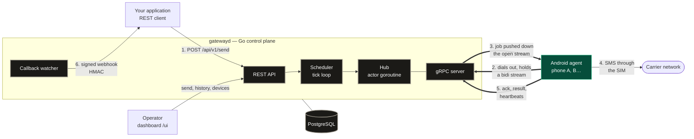

# Relaix

A self-hosted gateway that turns your Android phones into SMS and USSD nodes: send SMS, run
USSD codes (balances, bundles, mobile-money transfers), read the SMS the phones receive, and
let automations on the phones act on them — managed by a lightweight Go control plane over
gRPC, from a dashboard, a REST API or an AI assistant.

Rather not run it yourself? A hosted version runs at <https://relaix.kgmadev.com>.

## Status

**Working end to end, single instance — not yet hardened for production.**

`docker compose up --build` brings up Postgres and `gatewayd`; the operator dashboard is at
<http://localhost:8080/ui>. An Android phone running the agent enrolls by scanning a QR code
from the dashboard, holds its gRPC stream open, and carries out the jobs it is handed — from a
named SIM on a dual-SIM handset — reporting results back.

What exists today:

- **REST API, under `/api/v1`** — `POST /api/v1/send` (one or many recipients, queued or
  immediate, scheduled, expiring, pinned to a device or SIM), `POST /api/v1/ussd`, job history
  with filters and keyset paging, per-job timeline, cancellation, received SMS, devices and
  their rules, fleet stats, live events (`GET /api/v1/events`, server-sent). The unprefixed
  paths still answer, for integrations written before.
- **Webhooks** — one envelope for all, `{"event": "sms.delivered", "data": {…}}`, signed
  (HMAC-SHA256 of timestamp and body) and retried until acknowledged.
- **Dashboard** — overview, send and USSD (each showing the matching curl command), history,
  received SMS, devices, automations, integration guide with samples in curl, JavaScript,
  Python, Go, Rust and Java; light and dark themes, live updates.
- **Fleet** — one entry per physical phone (an HMAC of its hardware id), enable / disable /
  retire, and a phone can leave the fleet itself when its enrollment is forgotten.
- **Rules per device and per SIM** — availability hours, accepted countries, a number
  pattern, and send caps per hour and per day, edited from the dashboard, the phone or an
  assistant, and enforced by the scheduler. See [protocol.md §9](docs/protocol.md#9-device-rules).
- **USSD** — a code runs on a named phone and SIM; the network's answer comes back on the
  job, its webhook and the live stream. A code carrying a PIN can be marked `sensitive`:
  never shown, wiped once done. `replies` are typed into the menus the code opens, through an
  accessibility service the user switches on (`ussd_menu`).
- **Received SMS** — a phone forwards the SMS its rules name (e.g. `OrangeMoney`), kept until
  the server has them; listed by `GET /api/v1/inbox` and posted to a signed webhook.
  See [protocol.md §10](docs/protocol.md#10-ussd-and-received-sms).
- **Automations on the phone** — on a received SMS that matches (senders, a pattern with named
  fields, conditions), the phone itself forwards it with the extracted fields, replies by SMS,
  posts a signed webhook or runs a USSD code — offline included — and reports what it did.
  Each has a description, and can be viewed as a flow. SIM PINs stay on the phone: `{pin}` is
  filled in there, only for codes approved there, within caps.
  See [protocol.md §11](docs/protocol.md#11-automations-and-the-pin-vault).
- **Automation library** — ready-made templates installed like plugins: pick one, fill in a
  value or two (`GET /api/v1/automations/library`). The gateway ships some; the hosted
  platform's administrator publishes more, from the dashboard or an assistant.
- **AI assistants** — `/mcp` is a Model Context Protocol server: an assistant lists the phones,
  sends SMS, runs USSD codes, reads received SMS, sets each phone's rules, installs automations
  from the library or writes and tests its own. Every tool is a request to the API with the
  caller's key, so the key's account, permissions, rules and caps apply. Claude Code sends the
  key as a header; claude.ai connects by OAuth (the key pasted once, tokens sealed around it,
  nothing stored). For coding assistants, the dashboard also hands out a `SKILL.md` that
  teaches them the API.
- **Hosted platform** ([relaix-cloud](https://relaix.kgmadev.com), private) — accounts and
  users, monthly invoices, and API keys limited to chosen permissions (`sms:send`,
  `ussd:run`, `messages:read`, `inbox:read`, `devices:read`, `devices:write`) like
  fine-grained tokens.

Not there yet: more than one `gatewayd` instance (the hub is in-process; see
[architecture.md §9](docs/architecture.md#9-multi-instance-v2)), and the operational
hardening a public deployment needs — TLS is supported but not set up for you, and a
self-hosted gateway has a single shared key.

## Architecture

Relaix borrows the shape of the Kubernetes control plane. A Go server holds the registry
of known devices, receives heartbeats, and schedules work; each Android phone runs an agent
that dials out and holds an open gRPC bidirectional stream. Because phones sit behind
carrier NAT and are never reachable from the internet, the device always initiates the
connection and the server pushes jobs down the stream it already has.



Phones sit behind carrier NAT, so arrows 2 and 3 run over the one connection the phone
opened: the server never dials a device.

Full write-up, including the gRPC-vs-WebSocket decision and the known limitations:
**[docs/architecture.md](docs/architecture.md)**.

## Repository structure

| Path | Contents |
| --- | --- |
| `server/` | Go control plane — submodule → [relaix-server](https://github.com/KGMA74/relaix-server). |
| `android/` | Android agent — submodule → [relaix-agent](https://github.com/KGMA74/relaix-agent). |
| `proto/` | Protobuf contract shared by server and agent (`proto/smsgateway/v1/`). |
| `buf.yaml`, `buf.gen.yaml` | Lint and codegen for the contract. |
| `docs/` | Architecture and wire protocol. |
| `docker-compose.yml` | Local development stack: Postgres and `gatewayd`, dashboard included. |

Clone with the submodule:

```sh
git clone --recurse-submodules https://github.com/KGMA74/relaix.git
```

This repository holds **no Go module**. `proto/` is the single source of truth for the
contract, and `buf.gen.yaml` writes the generated Go into `server/`, where it is committed
in `relaix-server`. Each consumer repository owns the code generated from the contract:

```sh
buf lint && buf generate   # from this directory
```

## Docs

- [Architecture](docs/architecture.md) — components, design decisions, and their rationale.
- [Protocol](docs/protocol.md) — the gRPC service and every message on the wire.

## Author

Relaix is built by **[KGMA74](https://github.com/KGMA74)** — more work, write-ups and
contact details at **[kgmadev.com](https://kgmadev.com)**.

## License

[Apache License 2.0](LICENSE).
